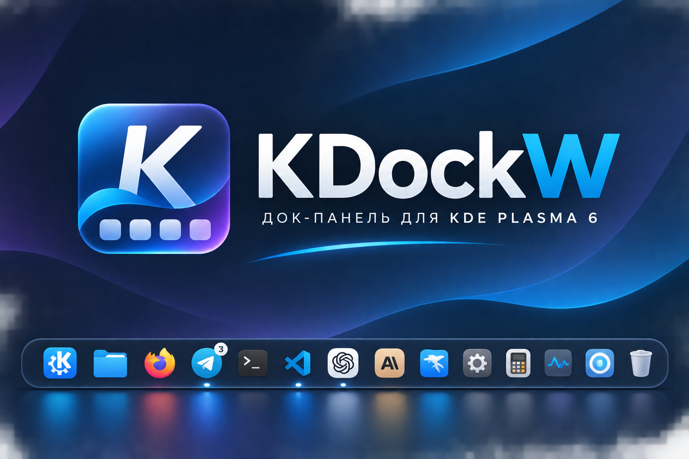

# KDockW

<p align="center"></p>

<p align="center"><strong>KDockW — KDE Dock for Wayland</strong></p>

<p align="center"><strong>A native Wayland dock for KDE Plasma 6.</strong></p>

<p align="center"><a href="README.ru.md">🇷🇺 Русский</a> · <a href="README.md">🇬🇧 English</a></p>

<p align="center">

[](#roadmap)
[](https://www.gnu.org/licenses/gpl-3.0)
[](https://kde.org/plasma-desktop/)
[](https://www.qt.io/)

</p>

<p align="center">
  <a href="#installation">Build and install</a> ·
  <a href="ROADMAP.md">Roadmap</a> ·
  <a href="CHANGELOG.md">Changelog</a> ·
  <a href="docs/migration/krema-to-kdockw.md">Migration from Krema</a>
</p>

KDockW is an independent KDE Plasma 6 dock for Wayland and a spiritual successor to Latte Dock. Written in C++23 with Qt 6 and KDE Frameworks 6, it provides parabolic icon zoom, window previews, app grouping, launch feedback, and Plasma integration.

## Project Highlights

| Area | KDockW behavior |
|---|---|
| Interface language | KI18n language selector: follow the system locale, choose Russian, or choose English; changes apply immediately. |
| Launch feedback | Launch-icon bounce ends after at most five complete cycles and can finish early after a window appears. |
| Plasma task-manager drag and drop | Reads the task launch URL MIME type while keeping `.desktop` launcher drops supported. |
| External file drag hover | Activates an existing app window after a configurable delay without consuming the file drag. |
| TaskManager diagnostics | Logs task rows and role changes without logging window titles or changing filtering. |
| PipeWire preview diagnostics | Logs capture state and keeps an experimental CPU-buffer retry for streams with no first frame; this is not a confirmed general DMA-BUF fix. |
| NVIDIA PRIME guidance | Documents observed behavior on one hybrid-GPU TUXEDO OS / Wayland setup. |

## Features

### Core Dock
- **Parabolic Zoom** — macOS-style magnification on hover that pushes neighbouring icons aside, with an optional in-place style
- **Zoom Animation** — Pick a hover zoom preset: Natural (default, eases in and out like the macOS Dock), Quick, Relaxed, or Instant; or switch to Custom to set zoom-in and zoom-out duration and easing separately
- **Icon Size Normalization** — Auto-detects icon padding and scales for uniform appearance
- **Indicator Dots** — Visual markers for running applications
- **Pin/Unpin** — Keep favorite apps in the dock
- **Context Menu** — Right-click for pin, close, new instance, and the app's own actions like "New Private Window" (KDE Breeze native)
- **Mouse Wheel Cycling** — Scroll to switch between windows of the same app
- **Single-Window Click Action** — Activate by default; optionally minimize the active window with a left click, while clicking a minimized or background window still restores or focuses it
- **Grouped-Window Click Action** — Cycle through windows by default, or independently choose previews of all windows or minimize only the currently active window; with no active group window, the minimize choice restores or focuses the most recently used window

### Visual Styles
- **Panel-Inherit** — Match your Plasma panel style automatically
- **Transparent** — Fully transparent dock background
- **Tinted** — Custom color with adjustable opacity
- **Acrylic / Frosted Glass** — Blur + noise texture effect

### Window Previews
- **PipeWire Thumbnails** — Live GPU-efficient window previews on hover
- **Multi-Window List** — All windows of grouped apps shown together; the optional grouped click action opens this list even with hover previews off
- **Click-to-Activate** — Click a preview to switch to that window
- **Preview Close Button** — Close windows directly from the preview popup

### Notifications & Attention
- **Notification Badges** — Badge count on dock icons via D-Bus and SmartLauncher Unity API
- **Badge Display Modes** — Choose between Number, Dot, or Off
- **6 Attention Animations** — Bounce, Wiggle, Pulse, Glow, Dot Color, and Blink
- **Task Progress Bar** — Progress indicator on dock icons (e.g. file copy in Dolphin)
- **Do Not Disturb** — Attention animations suppressed when system DND is active
- **Auto-Stop** — Attention animations stop after configurable duration (default 5s)

### Multi-Monitor & Virtual Desktops
- **Multi-Monitor Modes** — Primary monitor only, All monitors, Follow active screen, or Selected monitors
- **Per-Screen Settings** — Override icon size, edge, visibility mode per monitor
- **Follow Active Triggers** — Mouse, focus, or composite trigger for dock follows
- **Virtual Desktop Filtering** — Show all desktops, dim other desktops, or current only
- **Automatic Startup** — Launches on login, enforces single instance

Choose **Selected monitors** in Settings → Monitors & Desktops, then enable the switches for the output names you want. Each selected connected output with usable geometry gets a dock. Primary-display changes and unselected monitor connections or disconnections leave retained docks and previews in place. Disconnected selections stay listed and can be removed by turning their switches off.

If the selection is empty or no selected output is usable, KDockW shows a temporary dock on the primary display and a warning in Settings. The saved selection stays unchanged; reconnecting a selected monitor restores its dock and removes the fallback. Switching to another mode hides the selection controls without clearing the saved names.

In `kdockwrc`, `MonitorMode=3` means `SelectedScreens`; `SelectedOutputs` is a string list of exact output names such as `eDP-1` and `HDMI-A-1`. Existing values remain `0=PrimaryOnly` (default), `1=AllScreens`, and `2=FollowActive`.

### Integration & Accessibility
- **KDE Native Integration** — Kirigami UI, KDE color schemes, Plasma theme colors
- **Wayland Native** — Built on Layer Shell protocol for proper dock behavior
- **Smart Visibility** — Always visible, auto-hide, or dodge windows modes
- **Drag & Drop** — Reorder dock items, drop files onto apps, add launchers by dragging .desktop files, and optionally activate a running app after hovering dragged files over its icon
- **Settings UI** — Kirigami-based settings dialog (FormCard) for easy customization
- **Keyboard Accessibility** — Full keyboard navigation with AT-SPI screen reader support

### Keyboard Shortcuts

| Shortcut | Action |
|----------|--------|
| Meta+\` | Toggle dock visibility |
| Meta+1-9 | Activate Nth app |
| Meta+Shift+1-9 | Launch new instance of Nth app |
| Meta+Alt+D | Focus dock for keyboard navigation |
| Arrow keys | Navigate between dock items / preview thumbnails |
| Enter | Activate focused item |
| Escape | Exit keyboard navigation |

In Selected monitors mode, Toggle Dock and app-number shortcuts target the selected primary display, then the first selected output in the adopted compositor order, then the saved selection order. Focus Dock uses the dock on the cursor's screen when available; a cursor on an unselected output falls back to the same order.

## Installation

KDockW source builds are available; KDockW-specific binary packages have not yet been published. On TUXEDO OS, follow the [build guide](docs/building/tuxedo-os.md) for the current Qt/KDE package names and release build.

```bash
git clone --branch main --single-branch https://github.com/thicking/kdockw.git kdockw
cd kdockw
cmake --preset release -DCMAKE_INSTALL_PREFIX=/usr/local
cmake --build --preset release -j 4
sudo cmake --install build/release
```

The executable is installed as `/usr/local/bin/kdockw`; its desktop ID declares the KWin Wayland interfaces required by previews and activation. For an existing installation, read the [manual migration and rollback guide](docs/migration/krema-to-kdockw.md) before switching autostart or a user service. Installing KDockW does not remove or alter Krema.

To update the checkout, pull from `https://github.com/thicking/kdockw` and rebuild. CMake's configured build provides an `uninstall` target; otherwise remove only paths listed in that build's `install_manifest.txt`.

KDockW follows the system language by default. Open **Settings → General → Language** to choose **System default**, **Русский**, or **English**. The selected language is saved in `kdockwrc` and the KDockW interface updates immediately; this setting does not change Plasma's language or process-wide locale environment.

## Known Limitations

- The Russian catalog builds with KI18n. On systems without the Russian catalog, KI18n falls back to the English source strings. A real Wayland-session check is still needed after the new desktop ID is installed to confirm KWin grants the declared interfaces.
- The no-first-frame CPU-buffer retry is experimental. It is not a confirmed general fix for black previews or cross-GPU DMA-BUF import.
- File-drag activation was manually verified on Plasma 6.6.6 / Wayland with multiple files from Dolphin; the existing `.desktop` pinning path remains supported. Recheck after installing the renamed desktop entry.
- TaskManager diagnostics add evidence about model rows and roles but do not change KDE's task filtering.

## Roadmap

See [ROADMAP.md](ROADMAP.md) for the current development roadmap.

## Origins and Credits

KDockW is based on [Krema](https://github.com/isac322/krema), originally created by Byeonghoon Yoo, and is developed independently. The Git history and original file-level copyright notices are retained. KDockW is distributed under [GPL-3.0-or-later](LICENSES/GPL-3.0-or-later.txt), and all required license notices remain in the repository.

## Contributing

Contributions are welcome. Please open an issue to discuss a proposal before submitting a pull request.
