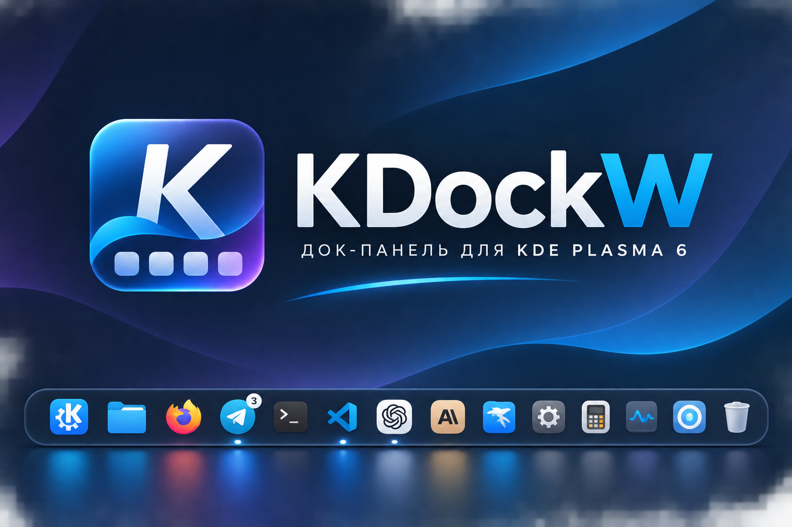
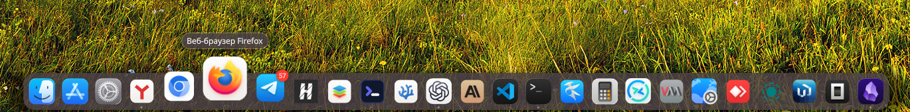
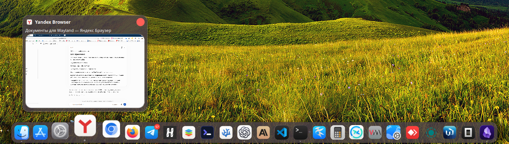
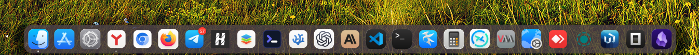

# KDockW

<p align="center"></p>

<p align="center"><strong>KDockW — KDE Dock for Wayland</strong></p>

<p align="center"><strong>Док-панель для KDE Plasma 6 под Wayland.</strong></p>

<p align="center"><a href="README.ru.md">🇷🇺 Русский</a> · <a href="README.md">🇬🇧 English</a></p>

<p align="center">

[](ROADMAP.md)
[](https://www.gnu.org/licenses/gpl-3.0)
[](https://kde.org/plasma-desktop/)
[](https://www.qt.io/)

</p>

<p align="center">
  <a href="#установка">Сборка и установка</a> ·
  <a href="ROADMAP.ru.md">План разработки</a> ·
  <a href="ROADMAP.md">English</a> ·
  <a href="CHANGELOG.md">История изменений</a> ·
  <a href="docs/migration/krema-to-kdockw.ru.md">Переход с Krema</a> ·
  <a href="docs/migration/krema-to-kdockw.md">English</a> ·
  <a href="README.md">English</a>
</p>

KDockW — самостоятельная док-панель для KDE Plasma 6 под Wayland и духовный преемник Latte Dock. Проект написан на C++23 с использованием Qt 6 и KDE Frameworks 6. В нём есть параболическое увеличение значков, предпросмотр окон, группировка приложений, анимация запуска и интеграция с Plasma.

Я самостоятельно развиваю KDockW на основе открытого проекта Krema и использую ИИ-агентов для разработки. Я формулирую требования и принимаю решения, а изменения проверяю в работающей сессии KDE Plasma под Wayland. История Git и авторство исходного проекта сохранены; подробнее — в разделе [Происхождение и благодарности](#происхождение-и-благодарности).

## Почему KDockW?

Я начал разрабатывать KDockW для собственного рабочего стола: мне хотелось создать современную, настраиваемую док-панель для KDE Plasma 6 под Wayland — с плавной анимацией и живым предпросмотром окон. Существующие решения не вполне отвечали моим требованиям. Поэтому я сосредоточился на удобстве повседневной работы, внешнем виде, интеграции с KDE и функциях, которых мне не хватало.

## KDockW в действии

Classic Zoom, анимация док-панели и живые миниатюры окон:

https://github.com/user-attachments/assets/da075b0f-4fcf-4d15-a608-a3b91eddcfcf

## Скриншоты

<p align="center">
  
</p>
<p align="center"><sub>Classic Zoom увеличивает значок под указателем, сохраняя видимость всего дока.</sub></p>

<table width="100%">
  <tr>
    <td align="center" width="50%">
      <br>
      <sub>Живой предпросмотр открытого окна.</sub>
    </td>
    <td align="center" width="50%">
      <br>
      <sub>Общий вид дока с закреплёнными приложениями и счётчиками уведомлений.</sub>
    </td>
  </tr>
</table>

## Возможности проекта

- **Для KDE Plasma 6 и Wayland** — док-панель, созданная специально для KDE Plasma 6 и Wayland.
- **Плавная работа** — Classic Zoom, настраиваемая анимация, анимация запуска приложений и индикаторы запущенных приложений.
- **Предпросмотр окон** — миниатюры открытых и свёрнутых окон, группы приложений и активация окна щелчком.
- **Настраиваемый внешний вид** — оформление панели, прозрачность значков, счётчики уведомлений и размеры карточек предпросмотра.
- **Пакеты для разных дистрибутивов** — проверенные пакеты для Debian, Ubuntu, Fedora, openSUSE и Arch Linux.

Об устройстве предпросмотра и устранении неполадок читайте в материалах: [архитектура и диагностика предпросмотра окон](docs/architecture/window-previews.md), [модели KDE TaskManager](docs/kde/taskmanager-models.md) и [NVIDIA PRIME / Wayland](docs/troubleshooting/nvidia-prime-wayland.md). Дополнительная диагностика модели задач записывает изменения строк и ролей, но не заголовки окон.

## Возможности

### Док-панель

- **Параболическое увеличение** — при наведении значки плавно растут и раздвигают соседние. Можно выбрать режим, в котором увеличенные значки перекрывают соседние.
- **Анимация увеличения** — выберите одну из предустановок: «Естественная» (по умолчанию), «Быстрая», «Плавная» или «Мгновенно». Также можно задать длительность увеличения и уменьшения и кривые ускорения.
- **Анимация запуска** — значок приложения подпрыгивает, пока не появится его окно, но не дольше пяти полных циклов.
- **Выравнивание размера значков** — KDockW компенсирует лишние прозрачные поля в изображениях, чтобы значки выглядели одинакового размера.
- **Внутренние отступы и выравнивание** — задайте отступы от каждого края фона дока (0–64 логических пикселя) и расположение ряда значков: в начале, по центру или в конце. Изменения применяются сразу и сохраняются.
- **Вид при первом запуске** — по умолчанию используются значки размером 40 px, интервал 13 px, внутренние отступы 8/8/8/0 px, увеличение 1,7 и тонированный фон `#4b4144` с тенью.
- **Индикаторы запущенных приложений** — выберите точку, линию, капсулу, свечение или полоску, задайте их расположение у края экрана или внутри дока, размер и цвет.
- **Закрепление приложений** — закрепляйте приложения в доке и открепляйте их.
- **Контекстное меню** — закрепляйте приложения, закрывайте окна, запускайте новые экземпляры и вызывайте действия самого приложения, например «Новое приватное окно» в Firefox.
- **Переключение колёсиком** — прокручивайте окна одного приложения с помощью колёсика мыши.
- **Действие при щелчке по одному окну** — по умолчанию окно активируется. Можно настроить сворачивание уже активного окна. Щелчок по свёрнутому или неактивному окну восстанавливает его или выводит на передний план.
- **Действие при щелчке по группе окон** — по умолчанию окна группы активируются по очереди. Вместо этого можно открыть предпросмотр всех окон или сворачивать только активное.

### Внешний вид

- **Как у панели Plasma** — фон автоматически подстраивается под оформление панели.
- **Прозрачный** — полностью прозрачный фон.
- **Тонированный** — настраиваемые цвет и прозрачность.
- **Акриловый** — размытие и текстура матового стекла.

### Предпросмотр окон

- **Миниатюры PipeWire** — живые миниатюры окон появляются при наведении.
- **Режим совместимости (CPU)** — по умолчанию KDockW использует автоматический режим с предпочтением DMA-BUF. Если миниатюры отображаются чёрными, включите режим совместимости; он может увеличить нагрузку на процессор.
- **Список окон группы** — окна одного приложения собраны в одном списке. Его можно открыть щелчком, даже если предпросмотр при наведении выключен.
- **Карточка предпросмотра** — настройте её размер, внутренние отступы и расстояние до дока. Кадр масштабируется с сохранением пропорций и обрезается по краям, чтобы заполнить область миниатюры.
- **Активация окна** — щёлкните по миниатюре, чтобы перейти к окну.
- **Закрытие окна** — закройте окно прямо в карточке предпросмотра.

### Уведомления и привлечение внимания

- **Счётчики уведомлений** — KDockW получает данные через D-Bus и API SmartLauncher Unity.
- **Отображение счётчика** — число, точка или полное отключение.
- **Индикаторы запущенных приложений** — пять стилей; можно выбрать расположение у края экрана или внутри дока, а также настроить размер и цвет.
- **Шесть анимаций внимания** — подпрыгивание, покачивание, пульсация, свечение, смена цвета точки и мигание.
- **Индикатор выполнения задачи** — например, показывает ход копирования файлов в Dolphin.
- **Режим «Не беспокоить»** — когда включён системный DND, анимации внимания приостанавливаются.
- **Остановка по таймеру** — анимация прекращается через заданное время (по умолчанию — через 5 секунд).
- **Проверка обновлений** — KDockW проверяет стабильные выпуски на GitHub автоматически или по запросу, показывает уведомление KDE и позволяет открыть страницу релиза. Обновления не скачиваются и не устанавливаются автоматически.

### Мониторы и рабочие столы

- **Режимы нескольких мониторов** — только основной монитор, все мониторы, следование за активным экраном или выбранные мониторы.
- **Параметры для каждого монитора** — размер значков, край экрана и режим видимости.
- **Следование за активным экраном** — по указателю, активному окну или обоим условиям.
- **Фильтрация виртуальных рабочих столов** — показывать все окна, приглушать окна с других столов или показывать только окна текущего стола.
- **Автозапуск** — запуск при входе в систему с защитой от нескольких экземпляров.

В разделе **Параметры → Мониторы и рабочие столы** выберите режим **Выбранные мониторы** и включите переключатели у нужных мониторов. Для каждого выбранного подключённого монитора с доступной геометрией появится отдельный док. Смена основного монитора и подключение или отключение невыбранных мониторов не пересоздают уже работающие доки и окна предпросмотра. Отключённые мониторы остаются в списке; их можно убрать, выключив переключатель.

Если список пуст или выбранные мониторы недоступны, KDockW временно показывает док на основном мониторе и предупреждение в параметрах. Сохранённый список не меняется: после подключения выбранного монитора док появится на нём, а временный док исчезнет.

В `kdockwrc` значение `MonitorMode=3` означает `SelectedScreens`, а `SelectedOutputs` содержит точные названия выходов, например `eDP-1` и `HDMI-A-1`. Другие значения: `0=PrimaryOnly` (по умолчанию), `1=AllScreens`, `2=FollowActive`.

### Интеграция и доступность

- **Интеграция с KDE** — интерфейс на Kirigami, цветовые схемы KDE и цвета темы Plasma.
- **Работа в Wayland** — док использует протокол Layer Shell.
- **Режимы видимости** — док можно оставить на экране, автоматически скрывать или убирать за окна.
- **Перетаскивание** — меняйте порядок значков, перетаскивайте файлы на приложения, добавляйте `.desktop`-ярлыки. Можно также настроить активацию приложения, если задержать над его значком перетаскиваемые файлы.
- **Окно параметров** — интерфейс на Kirigami FormCard; язык можно выбрать системный, русский или английский.
- **Клавиатура и экранный диктор** — навигация с клавиатуры и поддержка AT-SPI.

### Сочетания клавиш

| Сочетание | Действие |
|---|---|
| Meta+` | Показать или скрыть док |
| Meta+1–9 | Активировать приложение с соответствующим номером |
| Meta+Shift+1–9 | Запустить новый экземпляр приложения |
| Meta+Alt+D | Перейти к доку для навигации с клавиатуры |
| Стрелки | Перемещаться между значками и миниатюрами окон |
| Enter | Активировать выбранный элемент |
| Escape | Завершить навигацию с клавиатуры |

В режиме **Выбранные мониторы** команды показа дока и запуска приложения по номеру сначала обращаются к доку на выбранном основном мониторе. Если его нет, выбирается первый доступный док в порядке композитора, затем — первый доступный монитор в сохранённом списке. Команда фокусировки дока сначала ищет док на мониторе с указателем; если его там нет, применяется тот же порядок.

## Установка

KDockW 0.3.1 — последняя стабильная версия. Исходный архив, пакеты для
дистрибутивов и контрольные суммы доступны на странице
[релиза GitHub](https://github.com/thicking/kdockw/releases/tag/kdockw-v0.3.1).
Подробнее — в [политике версий](docs/releasing/versioning.md)
и [инструкции по выпуску](docs/releasing/release-process.md), а также в
[инструкции по сборке на TUXEDO OS](docs/building/tuxedo-os.md).

### Целевые Linux-дистрибутивы

Для каждого дистрибутива из списка ниже собирается отдельный пакет. Его
устанавливают в тестовый образ и проверяют док в наборе E2E-сценариев. Все 12
целей прошли матрицу выпуска v0.3.1. KDockW распространяется через GitHub
Releases; внешние репозитории пакетов не используются.

| Формат | Целевые дистрибутивы |
| --- | --- |
| `.deb` | Debian 13; Ubuntu 25.04, 25.10, 26.04 |
| `.rpm` | Fedora 42, 43, 44, Rawhide; openSUSE Tumbleweed, Slowroll, Leap 16.0 |
| `.pkg.tar.zst` | Arch Linux x86_64 |

Установите загруженный локальный пакет штатным менеджером:

```bash
sudo apt install ./kdockw-0.3.1-ubuntu-26.04.deb
sudo dnf install ./kdockw-0.3.1-fedora-44.rpm
sudo zypper install ./kdockw-0.3.1-opensuse-tumbleweed.rpm
sudo pacman -U ./kdockw-0.3.1-arch.pkg.tar.zst
```

```bash
git clone --branch main --single-branch https://github.com/thicking/kdockw.git kdockw
cd kdockw
cmake --preset release -DCMAKE_INSTALL_PREFIX=/usr/local
cmake --build --preset release -j 4
sudo cmake --install build/release
```

При сборке из исходников команды выше устанавливают исполняемый файл в `/usr/local/bin/kdockw`; пакетные сборки обычно используют `/usr/bin/kdockw`. Запись XDG autostart запускает установленный файл напрямую. В desktop-файле приложения объявлены интерфейсы KWin Wayland, необходимые для предпросмотра и активации окон. Если переходите с Krema, см. [инструкцию по переносу настроек и возврату](docs/migration/krema-to-kdockw.ru.md) ([English](docs/migration/krema-to-kdockw.md)). Если после старой сборки осталась служба `kdockw.service`, воспользуйтесь [инструкцией по переходу на XDG autostart](docs/migration/systemd-to-xdg-autostart.ru.md) ([English](docs/migration/systemd-to-xdg-autostart.md)). Установка KDockW не удаляет Krema и не меняет пользовательские файлы автозапуска.

Чтобы обновить исходники, получите изменения из `https://github.com/thicking/kdockw` и соберите проект заново. В сборке CMake доступна цель `uninstall`; если её нет, удаляйте только файлы, перечисленные в `install_manifest.txt` этой сборки.

По умолчанию KDockW использует язык системы. Откройте **Параметры → Общие → Язык**, чтобы выбрать **Автоматически (системный язык)**, **Русский** или **English**. Выбор сохраняется в `kdockwrc`, а интерфейс KDockW меняется сразу. Эта настройка не меняет язык Plasma или системную локаль процесса.

## Известные ограничения

- На системе с гибридной графикой в автоматическом режиме с DMA-BUF миниатюры отображались чёрными. Если столкнётесь с этим, включите **Параметры → Предпросмотр окон → Режим совместимости (CPU)**. На проверенной системе это восстановило миниатюры, но режим может увеличить нагрузку на процессор.
- Если каталог русской локализации недоступен, интерфейс отображается исходными английскими строками.

## План разработки

Актуальный план доступен на [русском](ROADMAP.ru.md) и [английском](ROADMAP.md).

## Происхождение и благодарности

KDockW создан на основе [Krema](https://github.com/isac322/krema), проекта Byeonghoon Yoo, и развивается независимо. История Git и уведомления об авторских правах в исходниках сохранены. KDockW распространяется по лицензии [GPL-3.0-or-later](LICENSES/GPL-3.0-or-later.txt); все обязательные лицензионные уведомления находятся в репозитории.

## Участие в разработке

Мы рады вкладу сообщества. Перед отправкой Pull Request создайте обсуждение в Issues.
